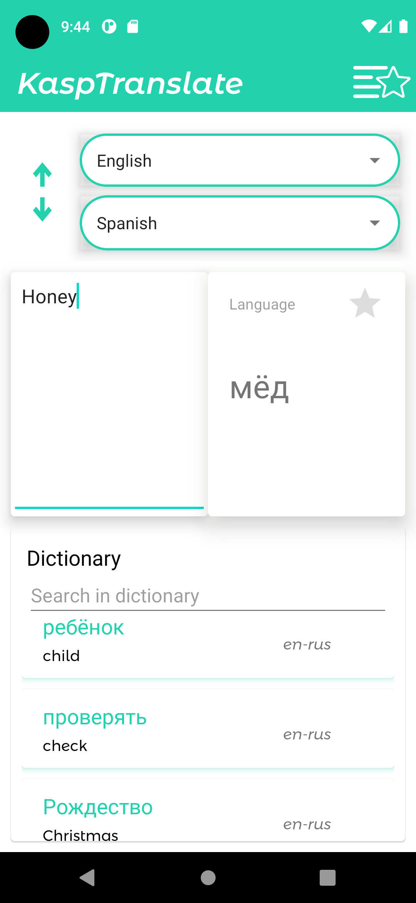

# TranslAppTestTask

Android-приложение для перевода слов и коротких фраз с сохранением истории поиска и избранного. Перевод выполняется через публичный API словаря Skyeng, локальные данные хранятся в Room.

## Скриншот



## Функционал

- перевод введенного слова или фразы;
- отображение результата перевода на главном экране;
- сохранение найденных слов в локальную историю;
- поиск по сохраненной истории;
- удаление элементов из истории;
- добавление и удаление слов из избранного;
- отдельный экран избранных слов;
- навигация между экраном перевода и экраном избранного;
- обработка ошибок запроса, удаления и изменения статуса избранного.

## Стек технологий

- Kotlin;
- Android Gradle Plugin 8.1.0;
- Gradle Wrapper 8.5;
- AndroidX, AppCompat, Material Components, ConstraintLayout;
- ViewBinding;
- Moxy для MVP-слоя;
- Dagger 2 для dependency injection;
- Cicerone для навигации;
- RxJava 2 и RxAndroid;
- Retrofit 2 для сетевых запросов;
- Gson converter для JSON;
- Room для локальной базы данных;
- Detekt для статического анализа.

## Структура проекта

Проект разбит на несколько Gradle-модулей:

- `app` - основной application-модуль. Содержит экран перевода, сетевой слой, Room-базу, репозиторий словаря, DI-граф приложения и запуск feature-модулей.
- `core-app-api` - общие API-контракты и модели переводчика: `TranslationApi`, `TranslatorInteractor`, `TranslatedWord`, `TranslatedEntity`.
- `feature-favourite-api` - публичный контракт фичи избранного: API и starter для открытия экрана.
- `feature-favourite-impl` - реализация экрана избранного: UI, presenter, adapter, interactor и Dagger-компонент фичи.
- `module-injector` - базовые интерфейсы для хранения и получения компонент между модулями.

Внутри модулей используется близкая структура пакетов:

- `data` - Retrofit API, Room DAO/database, repository;
- `domain` - interactors и бизнес-логика;
- `presentation` - Activity, View, Presenter, adapters;
- `di` - Dagger modules, components, scopes и providers.

## Запуск проекта

Требования:

- Android Studio;
- JDK 17 или JBR из Android Studio;
- установленный Android SDK;
- устройство или эмулятор с Android 8.0+ (`minSdk 26`).

Через Android Studio:

1. Открыть корневую папку проекта.
2. Дождаться Gradle Sync.
3. Выбрать конфигурацию `app`.
4. Запустить приложение на эмуляторе или устройстве.

Через терминал Windows:

```powershell
.\gradlew.bat assembleDebug
.\gradlew.bat installDebug
```

Если `JAVA_HOME` указывает на несуществующую Java, можно задать JBR Android Studio только для текущей PowerShell-сессии:

```powershell
$env:JAVA_HOME='C:\Program Files\Android\Android Studio\jbr'
.\gradlew.bat assembleDebug
```

Для macOS/Linux:

```bash
./gradlew assembleDebug
./gradlew installDebug
```

## Тестирование

Запуск unit-тестов:

```powershell
.\gradlew.bat test
```

Запуск instrumented-тестов на подключенном устройстве или эмуляторе:

```powershell
.\gradlew.bat connectedAndroidTest
```

Библиотеки, используемые при тестировании:

- JUnit 4 (`junit:junit`);
- MockK (`io.mockk:mockk`);
- MockK Android (`io.mockk:mockk-android`);
- AndroidX Test Ext JUnit (`androidx.test.ext:junit`);
- Espresso Core (`androidx.test.espresso:espresso-core`);
- RxJava `TestScheduler` и `TestObserver` в presenter-тестах.

## API

Базовый URL:

```text
https://dictionary.skyeng.ru/
```

Endpoint:

```text
GET api/public/v1/words/search?search={text}
```

Приложению требуется разрешение `INTERNET`.
